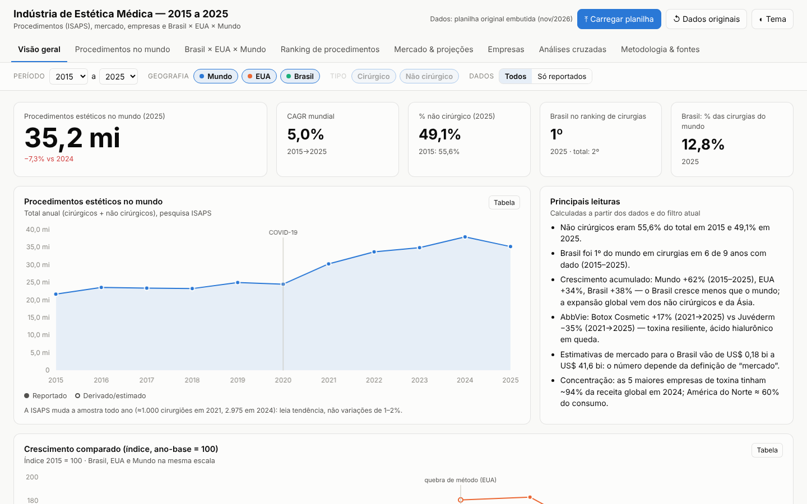
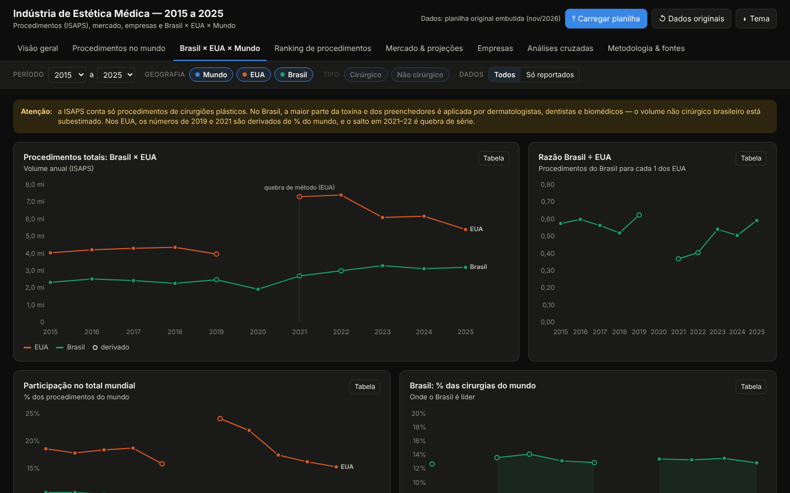

# Dashboard — Indústria de Estética Médica (2015–2025)

Dashboard interativo sobre procedimentos estéticos, mercado e empresas do setor, com foco em **Brasil × EUA × Mundo**.
Tudo roda em **um único arquivo HTML**: sem servidor, sem instalação, funciona offline.



## Como usar

- **Abrir localmente:** baixe o `index.html` e dê dois cliques.
- **Atualizar os dados:** clique em **Carregar planilha** e escolha uma nova versão do `.xlsx`. O navegador lembra da última planilha carregada; **Dados originais** volta para a versão embutida.

## O que tem no dashboard

| Aba | Conteúdo |
|---|---|
| Visão geral | KPIs (procedimentos no mundo, CAGR, % não cirúrgico, ranking do Brasil), série mundial, índice base 100 e leituras automáticas |
| Procedimentos no mundo | Cirúrgico × não cirúrgico (volume e mix), crescimento por tipo, toxina e ácido hialurônico, % homens, variação calculada × oficial |
| Brasil × EUA × Mundo | Totais, razão Brasil ÷ EUA, participação mundial, ranking, perfil cirúrgico, normalização por habitante e por cirurgião, registros Anvisa |
| Ranking de procedimentos | Top procedimentos, variação anual (barras divergentes), líder de cada ano |
| Mercado & projeções | Base → projeção por consultoria, CAGR reportado × recalculado, dispersão das estimativas (log), série MarketsandMarkets |
| Empresas | Receita em US$ (câmbio ajustável), tamanho × crescimento, toxina × preenchedor, série AbbVie |
| Análises cruzadas | Volume ISAPS × receita (Botox / Juvéderm), gasto implícito por procedimento, simulador de penetração |
| Metodologia & fontes | Mapa de cobertura (reportado / derivado / sem dado), % de valores derivados por aba, ressalvas e fontes |

**Filtros:** período, geografia, tipo de procedimento e “Só reportados” (esconde valores derivados), além de filtros por aba.
Cada gráfico tem botão **Tabela**; há tema claro/escuro.



## Regras para atualizar a planilha

O dashboard localiza os dados **pelo nome das abas e dos cabeçalhos**, não pela posição das células. Pode adicionar anos, linhas e empresas à vontade, desde que:

1. Os nomes das abas continuem os mesmos (`ISAPS_Global`, `Paises_EUA_Brasil`, `Procedimentos`, `Mercado_Projecoes`, `Empresas`, `AbbVie_Serie`, `Brasil_Comparativo`, `Fontes`, `Leia-me`).
2. Os textos dos cabeçalhos sejam mantidos (ex.: `Ano`, `Cirúrgicos`, `Não cirúrgicos`, `Consultoria`, `Empresa`…).
3. **Fundo amarelo** continue marcando valor derivado/estimado: o dashboard lê a cor da célula.

Se a planilha for salva sem os resultados das fórmulas (comum em arquivos gerados por script), o dashboard calcula as fórmulas sozinho (aritmética, referências entre abas, `IF`, `IFERROR`, `SUM`, `ROUND`…).

## Estrutura do repositório

```
├── index.html              # dashboard pronto (gerado pelo build)
├── data/
│   └── banco_dados_estetica_medica.xlsx
├── src/
│   ├── template.html       # HTML + CSS
│   ├── app1_data.js        # leitor de .xlsx no navegador + modelo de dados
│   ├── app2_ui.js          # estado, formatação, componentes e plugins de gráfico
│   └── app3_pages.js       # filtros, abas e páginas
├── scripts/
│   └── build.py            # junta tudo num único index.html
├── docs/                   # imagens do README
└── package.json            # dependências (Chart.js, fflate)
```

## Build (para quem for alterar o código)

Requisitos: Node.js (só para baixar as bibliotecas) e Python 3.

```bash
npm install
python3 scripts/build.py                              # gera index.html com data/banco_dados_estetica_medica.xlsx
python3 scripts/build.py outra_planilha.xlsx saida.html   # opcional: outra planilha / outro destino
```

O build embute no HTML o Chart.js, o fflate (descompactação do .xlsx) e a planilha em base64.


## Fontes e ressalvas

Dados compilados de fontes públicas (ISAPS Global Survey, relatórios anuais das empresas e consultorias de mercado). A lista completa, com links, está na aba **Metodologia & fontes** e na aba `Fontes` da planilha.

- A ISAPS só conta procedimentos feitos por cirurgiões plásticos: o volume não cirúrgico do Brasil está subestimado.
- A amostra da ISAPS muda todo ano. A série serve para ler tendência, não variações pequenas.
- “Tamanho de mercado” varia muito conforme o escopo de cada consultoria. Não compare escopos diferentes.

## Tecnologias

HTML, CSS e JavaScript puro · [Chart.js](https://www.chartjs.org/) (MIT) · [fflate](https://github.com/101arrowz/fflate) (MIT) · Python (build)
